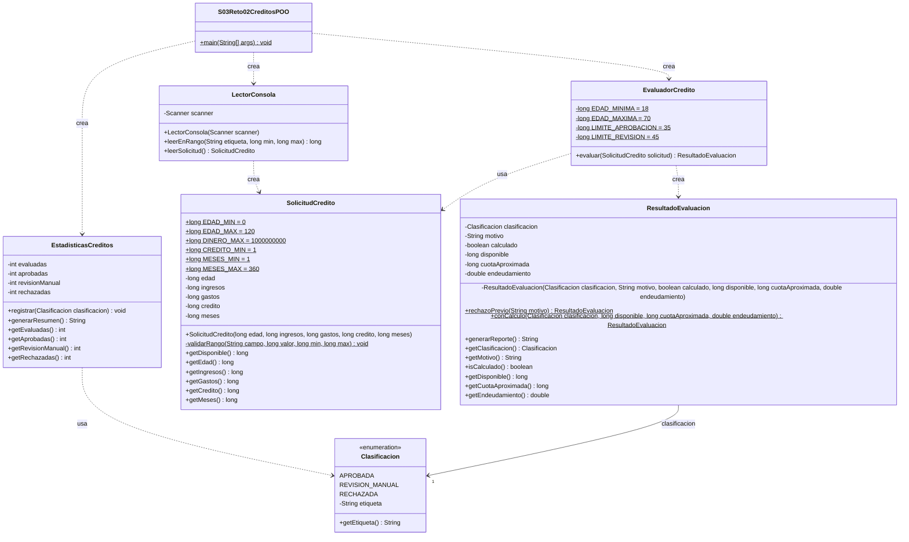

# Reto 2 · Simulador de créditos (versión POO)

La misma especificación del reto 2, ahora repartida en clases con una responsabilidad cada una.

| Clase | Responsabilidad |
| --- | --- |
| `S03Reto02CreditosPOO` | `main`: menú 1/0 y coordinación de los objetos. |
| `LectorConsola` | Encapsula el `Scanner`; vuelve a pedir datos no numéricos o fuera de rango. |
| `SolicitudCredito` | Datos de la solicitud (inmutables); el constructor rechaza valores fuera de rango. |
| `EvaluadorCredito` | Reglas: edad 18–70, ingresos > gastos, límites de 35 % y 45 %. |
| `ResultadoEvaluacion` | Clasificación, motivo de rechazo o datos calculados, y su reporte. |
| `Clasificacion` | `enum` con APROBADA, REVISIÓN MANUAL y RECHAZADA. |
| `EstadisticasCreditos` | Contadores de evaluadas y de cada categoría, y el resumen final. |

## Diagrama UML



Notación: `+` público, `-` privado, subrayado = `static`. Flecha discontinua = dependencia (la clase
crea o usa a la otra); flecha continua = asociación (la guarda como atributo). Todos los atributos de
`SolicitudCredito`, `ResultadoEvaluacion`, `Clasificacion` y `LectorConsola`, y las constantes, son `final`.

## Precisión

La categoría se decide con enteros exactos: `credito * 100` frente a `disponible * meses * 35` y `* 45`
(máximo 1.62e13, cabe en `long`). La cuota en pesos se muestra truncada y se indica que es aproximada;
el porcentaje es un `double` solo para mostrar. Si edad o ingresos ≤ gastos fallan, se rechaza sin dividir.

## Ejecución

Desde `reto-02-creditos/`:

```bash
javac -d out s03reto02poo/*.java
java -cp out s03reto02poo.S03Reto02CreditosPOO
```

Las seis pruebas mínimas del enunciado dan: 6 evaluadas, 1 aprobada, 2 en revisión y 3 rechazadas.
Meses = 0 se vuelve a pedir y finalizar de inmediato muestra los cuatro contadores en cero.
